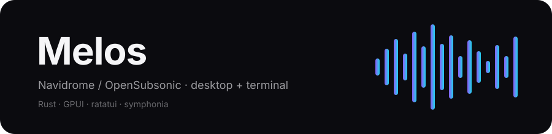

<div align="center">
  
  <br><br>
  
  
  
  
  
  <br><br>
  <b>Navidrome / OpenSubsonic 的原生桌面与终端音乐客户端</b><br>
  <sub>Rust · GPUI · ratatui · symphonia · 无 WebView、无 MPV、无 GStreamer</sub>
</div>

---

Melos 是一个面向自建音乐库的 Windows 客户端。桌面端使用 GPUI，终端端使用 ratatui，两者共用同一套播放引擎、队列状态机、歌词与设置。它不是网页套壳：界面、解码与音频输出都是原生的。

**当前版本 0.1.17（技术预览）。** 主要功能已接通并通过自动化检查；真实媒体键与冷启动已确认，剩余完整界面交互矩阵逐项确认，详见[发布状态](#发布状态)。

## 亮点

- **两套前端，一个内核**：桌面与终端共享队列、随机范围、歌词、设置和多音乐源，行为一致。
- **终端可独立使用**：TUI 自带登录与音乐源管理，不需要先运行桌面版。
- **为自建曲库设计**：专辑/艺人/歌单/全部歌曲分页加载，长列表可见行渲染，封面按需缓存。
- **限定范围随机**：多选若干专辑或艺人后随机播放，并在同一范围内持续续播，而不是每首跳回全库。
- **多音乐源**：每个服务器独立保存账号与 DPAPI 密码；添加不切换，切换时才断开重连。
- **完整歌词体验**：同步行居中、点击跳转、多版本切换、纯文本回退。
- **搜索即标记**：桌面搜索结果可直接标记艺人；终端在艺人页按 `/` 搜索艺人并标记。

## 下载

最新版可从 [GitHub Releases](https://github.com/youbilin/Melos/releases/latest) 下载；本地构建产物由 `./packaging/build-windows.ps1` 生成于 `output/release/`，每个 ZIP 旁附 `.sha256`。

| 包 | 大小 | 内容 |
|---|---:|---|
| `melos-0.1.17-windows-x64.zip` | 8.48 MB | 桌面版 + 终端版 |
| **`melos-tui-0.1.17-windows-x64.zip`** | **2.42 MB** | **仅终端版** |

> **只想要终端？** 直接下载 `melos-tui-0.1.17-windows-x64.zip`，解压运行 `melos-tui.exe` 即可，不需要桌面组件。首次启动按 `6` 添加音乐源并登录。

SHA256：

```
c6f1a4e4d760b3eeaa586d6edd90fe78f76962920ef3d54e7ededd3cbadb7e9b  melos-0.1.17-windows-x64.zip
25785881e22f73ac2fb03ba87f66988885c997ac72af328dc84576a68f294617  melos-tui-0.1.17-windows-x64.zip
```

**系统要求**：Windows 10 1903+ 或 Windows 11（x64），并安装 [Microsoft Visual C++ 2015–2022 Redistributable (x64)](https://aka.ms/vs/17/release/vc_redist.x64.exe)。

## 快速开始

### 桌面版

1. 解压并运行 `melos.exe`。
2. 填写服务器地址、用户名、密码，点击“连接”。
3. 在设置页选择音质；密码由 Windows DPAPI 加密保存。

### 终端版

1. 在 Windows Terminal 或 PowerShell 中运行 `melos-tui.exe`。
2. 没有保存连接时会停在“音乐源”页；按 `a` 依次输入服务器、用户名、密码，Enter 提交并连接。
3. 已有音乐源时用 `↑/↓` 选择、`Enter` 连接；`d` 删除非当前源。

## 终端界面

```text
┌ Melos 0.1.17 · 1 Albums · 2 Playlists · 3 Queue · 4 Lyrics · 5 Songs · 6 Sources · 7 Artists ┐
│ ›  专辑名称 · 艺人                                                                        │
│    另一张专辑 · 艺人                                                                      │
│    ...                                                                                    │
├ Now Playing · 歌曲名 · 03:12 / 04:28 · Vol 80% · Shuffle true · Repeat Off ───────────────┤
│ 80 albums loaded · Space pause · n/p skip · x mark · R shuffle marked · Esc back · q quit │
└───────────────────────────────────────────────────────────────────────────────────────────┘
```

| 键 | 作用 |
|---|---|
| `1`–`7` | 专辑 / 歌单 / 队列 / 歌词 / 全部歌曲 / 音乐源 / 艺人 |
| `/` | 搜索歌曲与艺人，结果按艺人、歌曲排列（Enter 提交，Esc 取消） |
| `↑` `↓` 或 `k` `j` | 选择条目 |
| `Enter` | 打开专辑、歌单、艺人，播放歌曲，连接音乐源 |
| `空格` | 播放 / 暂停 |
| `n` / `p` | 下一首 / 上一首 |
| `←` / `→` | 快退 / 快进 5 秒 |
| `+` / `-` | 音量 |
| `s` / `r` | 随机 / 循环 |
| `x` / `R` | 标记当前专辑或艺人 / 随机播放已标记范围 |
| `a` / `i` | 加入队列 / 下一首播放（歌曲页） |
| `d` / `J` / `K` / `D` | 移除 / 下移 / 上移 / 清空待播（队列页） |
| `L` | 加载更多（专辑页、全部歌曲页） |
| `t` | 切换歌词版本（歌词页） |
| `e` | 重新连接音频输出 |
| `Esc` | 取消输入 / 返回上一级 |
| `q` 或 `Ctrl+C` | 退出 |

终端版暂不支持歌单编辑、艺人/专辑搜索和系统媒体键，这些请使用桌面版。

## 功能

| 模块 | 能力 |
|---|---|
| 播放 | 流式播放、gapless、seek、预取、断流恢复；单曲/列表循环；随机可限定专辑/艺人范围 |
| 解码 | 本地 WAV、FLAC、MP3、AAC/ALAC、Vorbis；其他格式请求服务端转码 |
| 曲库 | 专辑、艺人、歌单、全部歌曲、收藏、搜索；分页与可见行渲染 |
| 全部歌曲 | 每页 200 首，按艺人 → 专辑 → 碟号 → 音轨排序 |
| 歌词 | 同步行居中缓动、点击跳转、多版本、纯文本/LRC、旧接口回退 |
| 队列 | 下一首播放、整张追加、移除、拖动排序、清空待播，编辑不打断音频 |
| 音乐源 | 多服务器、独立 DPAPI 密码、显式切换、旧配置自动迁移 |
| 系统集成 | Windows SMTC、媒体封面、快捷键；输入框与中文输入法组合保护 |
| 终端 | 独立登录、音乐源管理、专辑/艺人标记随机、歌词、队列编辑 |

## 架构

```text
crates/
  melos-api/      Subsonic / OpenSubsonic 客户端：认证、DTO、流 URL、错误映射
  melos-player/   symphonia 解码 + cpal 输出：预取、seek、gapless、断流恢复
  melos-core/     队列、歌词、曲库排序、设置与 DPAPI 凭据（无 UI 依赖）
  melos-app/      GPUI 桌面端（唯一依赖 gpui 的 crate）
  melos-tui/      ratatui 终端端（复用 core / player / api）
```

领域层与播放器不依赖 UI 工具包；GitHub Actions 会检查底层 crate 的依赖图。

## 构建

工具链固定在 `rust-toolchain.toml`（Rust 1.99.0，MSVC 目标），需要 Visual Studio Build Tools（C++ 工作负载）和 Windows SDK。

```powershell
# 先进入 MSVC 开发者环境
cargo build --release --locked -p melos-app -p melos-tui

# 打包桌面+终端、仅终端两个 ZIP
./packaging/build-windows.ps1
```

常用检查：

```powershell
cargo fmt --all --check
cargo test --workspace --locked
cargo clippy --workspace --all-targets --locked -- -D warnings
```

> 在 Git Bash 中直接运行 `cargo` 可能误用其他 `link.exe`，请通过 `cmd /c "\"...\vcvars64.bat\" && cargo ..."` 或已导入 MSVC 环境的 PowerShell 执行。

## 质量与验收

- 97 个自动化测试通过，1 个 30 秒断流长测试显式忽略；覆盖解码、seek、gapless、断流恢复、队列、随机、设置迁移与 TUI 交互。
- `cargo fmt` 与 `cargo clippy -D warnings` 通过。
- 真实服务验证：FLAC 整曲与跨曲播放、40 首随机样本完整解码、转码流曲尾修复、终端隔离配置登录并加载 80 张专辑。
- 发布包：桌面 13.66 MB、终端 5.22 MB，空闲工作集约 47–48 MB。

### 发布状态

- 已完成：浏览、搜索、播放、队列、歌词、歌单、多源、终端独立登录、限定范围随机。
- 真实媒体键：用户已确认 Win+A 媒体卡与键盘控制正常（2026-11-13）。
- 冷启动：三次新进程的可见窗口为 212–238 ms；首次运行新二进制约 1.5–2.5 s，属系统扫描。
- 待确认：拖动、中文输入、缩放与长列表的完整界面矩阵。
- 80 分钟真实服务长测已按用户要求取消，不再作为发布门槛。

## 常见问题

**只想下载终端版？**
下载 `melos-tui-0.1.17-windows-x64.zip`，解压后运行 `melos-tui.exe`。TUI 可独立登录，不依赖桌面版。

**怎么切换音乐源？**
桌面：设置 → 音乐源 → 切换。终端：按 `6`，选中后 Enter。切换会停止当前播放并清空队列。

**随机能只放某些专辑或艺人吗？**
可以。桌面在专辑/艺人页多选，或在搜索结果、专辑/艺人详情页直接点“标记”；终端在专辑/艺人页用 `x` 标记、`R` 播放，艺人页按 `/` 可先搜索。标记会保留到清空或普通播放，队列结束后继续在该范围续抽。

**支持系统媒体键吗？**
桌面接入 Windows SMTC，系统媒体面板与媒体键可控制播放；真实键盘的最终确认仍待验收。

**配置存在哪？**
`%APPDATA%\melos\settings.json`。密码由 DPAPI 加密。设置 `MELOS_CONFIG_DIR` 可让桌面与终端使用完全独立的配置目录。

**支持 macOS / Linux 吗？**
当前只发布 Windows x64；底层 crate 不依赖 GPUI，但尚未提供其他平台构建。

## 许可证

GPL-3.0-or-later。第三方组件声明见 `packaging/THIRD_PARTY_NOTICES.md`。

---

<div align="center">
  <sub>如果 Melos 对你有帮助，欢迎在仓库点一个 Star。</sub>
</div>
