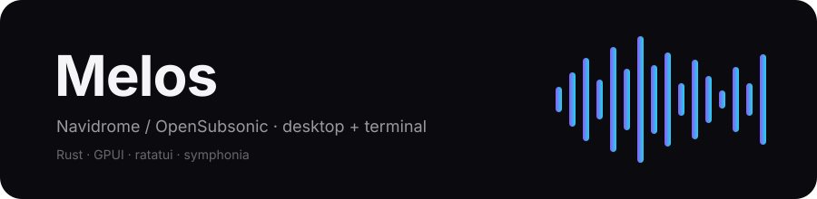

<div align="center">
  
  <br><br>
  
  
  
  
  
  <br><br>
  <b>Navidrome / OpenSubsonic 的原生桌面与终端音乐客户端</b><br>
  <sub>Rust · GPUI · ratatui · symphonia · 无 WebView · 无 MPV · 无 GStreamer</sub>
</div>

---

Melos 是一个面向自建音乐库的 Windows 客户端。桌面端使用 GPUI，终端端使用 ratatui，两端共享同一套播放引擎、队列状态机、歌词解析与设置存储——界面、解码与音频输出全部原生实现，不依赖任何 WebView 或多媒体运行时。

## 特性

### 播放

- 原生解码：WAV、FLAC、MP3、AAC/ALAC、Vorbis；其他格式自动请求服务端转码
- 无缝续播：整个待播列表预取 + 原子环形缓冲，切歌零欠载
- 断流恢复：曲尾连接中断按正常结束处理，弱网下自动重试
- 随机 / 单曲 / 列表循环，随机开启时从全库取歌并在队列结束后持续续抽

### 曲库与搜索

- 专辑、艺人、歌单、全部歌曲分页加载，长列表可见行渲染，万首级曲库流畅滚动
- 封面按需加载与磁盘缓存
- 桌面搜索返回艺人、专辑、歌曲三段结果；终端一次搜索艺人与歌曲
- 限定范围随机：在搜索结果、专辑/艺人详情页直接标记，或专辑/艺人页多选，队列结束后继续在同一范围续抽

### 队列

- 下一首播放、追加歌曲或整张专辑、拖动排序、移除、清空待播
- 编辑队列时替换未来已解码音频，不打断当前歌曲

### 歌词

- 同步行居中缓动跟随、点击行跳转、多版本切换、纯文本与 LRC 回退
- 全屏歌词：桌面 `Ctrl+L`、终端 `f`，当前句大字居中实时跟随

### 多音乐源

- 每个服务器独立保存账号，密码经 Windows DPAPI 加密
- 添加只入库、切换才重连；旧配置自动迁移
- 终端自带登录与音乐源管理，无需先运行桌面版

### 系统集成

- Windows SMTC：媒体键、Win+A 媒体卡、封面与进度同步
- 全局快捷键；输入框与中文输入法组合保护

## 下载

最新版从 [GitHub Releases](https://github.com/youbilin/Melos/releases/latest) 获取。

| 包 | 大小 | 内容 |
|---|---:|---|
| `melos-0.1.19-windows-x64.zip` | 8.50 MB | 桌面版 + 终端版 |
| [`melos-tui-0.1.19-windows-x64.zip`](https://github.com/youbilin/Melos/releases/latest) | 2.43 MB | 仅终端版 |

每个 ZIP 旁附 `.sha256` 校验文件：

```
0a7c26c2852ec9a50866115622b14b69ce6de4c9bb3e9ccadf7705332afe2630  melos-0.1.19-windows-x64.zip
9c81706ae2a84c318a6eee6393951e30557bdb1bf8541ad0e1b0d09b001fe883  melos-tui-0.1.19-windows-x64.zip
```

**系统要求**：Windows 10 1903+ 或 Windows 11（x64），[Microsoft Visual C++ 2015–2022 Redistributable (x64)](https://aka.ms/vs/17/release/vc_redist.x64.exe)。

## 快速开始

**桌面版**

1. 解压并运行 `melos.exe`
2. 填写服务器地址、用户名、密码，点击“连接”
3. 在设置页选择音质；密码由 DPAPI 加密保存

**终端版**

1. 在 Windows Terminal 或 PowerShell 中运行 `melos-tui.exe`
2. 没有保存连接时停在“音乐源”页，按 `a` 依次输入服务器、用户名、密码
3. `↑/↓` 选择、`Enter` 连接；`d` 删除非当前源

配置保存在 `%APPDATA%\melos\settings.json`；设置 `MELOS_CONFIG_DIR` 可让桌面与终端使用完全独立的配置目录。

## 键盘操作

**桌面**

| 键 | 作用 |
|---|---|
| `空格` | 播放 / 暂停 |
| `←` / `→` | 快退 / 快进 5 秒 |
| `Ctrl+←` / `Ctrl+→` | 上一首 / 下一首 |
| `Ctrl+↑` / `Ctrl+↓` | 音量 |
| `↑` / `↓` + `Enter` | 列表选择，打开专辑 / 艺人 / 歌单或播放歌曲 |
| `Ctrl+S` / `Ctrl+R` / `Ctrl+Q` / `Ctrl+F` / `Ctrl+L` | 随机 / 循环 / 队列 / 搜索 / 全屏歌词 |

**终端**

| 键 | 作用 |
|---|---|
| `1`–`7` | 专辑 / 歌单 / 队列 / 歌词 / 全部歌曲 / 音乐源 / 艺人 |
| `/` | 搜索艺人与歌曲（Enter 提交，Esc 取消） |
| `↑` `↓` 或 `k` `j` | 选择条目，`Enter` 打开 / 播放 |
| `空格` | 播放 / 暂停 |
| `n` / `p` | 下一首 / 上一首 |
| `←` / `→` | 快退 / 快进 5 秒 |
| `+` / `-` | 音量 |
| `s` / `r` | 随机 / 循环 |
| `x` / `R` | 标记专辑或艺人 / 随机播放已标记范围 |
| `a` / `i` | 加入队列 / 下一首播放 |
| `d` / `J` / `K` / `D` | 移除 / 下移 / 上移 / 清空待播（队列页） |
| `L` | 加载更多 |
| `f` | 全屏居中歌词（Esc 退出） |
| `t` | 切换歌词版本 |
| `e` | 重新连接音频输出 |
| `Esc` / `q` | 返回上一级 / 退出 |

## 架构

```text
crates/
  melos-api/      Subsonic / OpenSubsonic 客户端：认证、DTO、流 URL、错误映射
  melos-player/   symphonia 解码 + cpal 输出：预取、seek、gapless、断流恢复
  melos-core/     队列、歌词、曲库排序、设置与 DPAPI 凭据（无 UI 依赖）
  melos-app/      GPUI 桌面端（唯一依赖 gpui 的 crate）
  melos-tui/      ratatui 终端端（复用 core / player / api）
```

领域层与播放器不依赖 UI 工具包；GitHub Actions 会检查底层 crate 的依赖图。

## 从源码构建

工具链固定在 `rust-toolchain.toml`（Rust 1.99.0，MSVC 目标），需要 Visual Studio Build Tools 的 C++ 工作负载与 Windows SDK。

```powershell
# 在 MSVC 开发者环境中执行
cargo build --release --locked -p melos-app -p melos-tui

# 打包桌面 + 终端、仅终端两个 ZIP
./packaging/build-windows.ps1
```

```powershell
cargo fmt --all --check
cargo test --workspace --locked
cargo clippy --workspace --all-targets --locked -- -D warnings
```

> Git Bash 下直接运行 `cargo` 可能误用其他 `link.exe`，请通过 MSVC 开发者环境执行。

## 质量保证

- 98 个自动化测试：解码、seek、gapless、断流恢复、队列状态机、随机续抽、设置迁移与终端交互
- `cargo fmt` 与 `cargo clippy -D warnings` 全量通过，CI 覆盖测试与 Windows 打包
- 真实服务验证：FLAC 整曲与跨曲播放、40 首随机样本完整解码、转码流曲尾修复、万首曲库滚动
- 性能实测：exe 13.70 MB，可见窗口启动 212–238 ms，空闲工作集约 48 MB
- 发布验收清单（媒体键、冷启动、界面交互矩阵、格式矩阵）已全部确认

## 已知限制

- 仅提供 Windows x64 构建；底层 crate 不依赖 GPUI，具备跨平台条件但尚未验证
- 终端版暂不支持歌单编辑、专辑搜索与系统媒体键
- 应用未做代码签名，首次运行可能触发 SmartScreen 提示

## 常见问题

**怎么切换音乐源？**
桌面：设置 → 音乐源 → 切换；终端：按 `6`，选中后 `Enter`。切换会停止当前播放并清空队列。

**随机能只放某些专辑或艺人吗？**
可以。桌面在专辑/艺人页多选，或在搜索结果、详情页直接点“标记”；终端在专辑/艺人页用 `x` 标记、`R` 播放。标记保留到清空或普通播放，队列结束后继续在同一范围续抽。

**支持系统媒体键吗？**
支持。桌面接入 Windows SMTC，Win+A 媒体卡与键盘媒体键均可控制播放。

**密码安全吗？**
密码使用 Windows DPAPI 按用户加密后存盘，配置文件中不包含明文。

**支持 macOS / Linux 吗？**
当前只发布 Windows x64。

## 许可证

[GPL-3.0-or-later](LICENSE)。第三方组件声明见 [`packaging/THIRD_PARTY_NOTICES.md`](packaging/THIRD_PARTY_NOTICES.md)。

---

<div align="center">
  <sub>如果 Melos 对你有帮助，欢迎在仓库点一个 Star。</sub>
</div>
